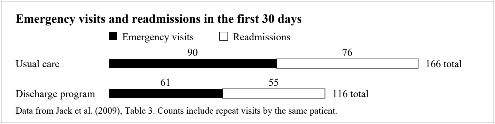

---
# Sources (not rendered):
# Jack et al., Annals of Internal Medicine, Feb 3 2009; Boston Medical Center; 370 intervention / 368 usual care analyzed; 116 vs 166 utilizations; ED 61 vs 90 (P=.014), readmissions 55 vs 76 (P=.090); pharmacist reached 228, completed review 195, 126 with at least one problem; nurse ~87.5 min, pharmacist ~26 min; English-speaking adults -> https://www.bu.edu/fammed/projectred/AnnalsArtcile2-09.pdf
# Teach-back -> https://www.ahrq.gov/health-literacy/improve/precautions/tool5.html
# RED toolkit -> https://www.ahrq.gov/patient-safety/settings/hospital/red/toolkit/index.html
title: 'The Instructions You Read at Home'
author: Anay Gupta
category: public health
date: 2026-11-24T00:00:00.000Z
layout: layouts/post.njk
tags:
  - health
  - hospitals
  - patient care
  - medication safety
excerpt: >-
  A hospital trial found fewer return visits when a written discharge plan
  came with help using it at home.
image: /assets/images/2026/the-instructions-you-read-at-home.jpg
image_credit: 'Amanda Mills / CDC Public Health Image Library'
---

A patient leaves the hospital with a new prescription. At home, there's still a bottle of the old medicine in the kitchen. Which one are they supposed to reach for tomorrow morning? The discharge papers have to answer that question when the person who handed them over is miles away.

A medication list can be written in plain language and still leave that decision unresolved. The patient needs to know whether the new prescription replaces a medicine they already take, adds to it or changes the dose. A hospital trial treated the paperwork as one step in making sure the plan reached the patient.

## The booklet had backup

Researchers at Boston Medical Center tested a different approach in a [randomized trial published in 2009](https://www.bu.edu/fammed/projectred/AnnalsArtcile2-09.pdf). A nurse worked through patients' medication lists, arranged follow-up appointments and reviewed a personalized booklet before they left. The primary care provider received a copy. The program called for a pharmacist to follow up by phone a few days later and ask patients to bring their actual medicines to the phone.

In the first 30 days, the group offered the program recorded 116 emergency department visits or readmissions. The group receiving usual care recorded 166. Each group had about 370 people. Those totals count trips, including more than one trip by the same person. The result was clearer for emergency department visits than for readmissions on their own.

## What the phone call found

The pharmacist reached 228 of the 370 patients offered the program and completed a medication review with 195. Of those 195, 126 had at least one medication problem. That figure describes the people whose medicines were reviewed. It also gives a sense of what a follow-up call can uncover after a patient leaves with a written plan.

The program also took staff time. The researchers estimated about an hour and a half of nursing time and half an hour of pharmacist time per participant. Some of that overlapped with work hospital staff already did. A hospital looking at the drop in return visits would still have to work out who has time to review the plan and make those calls.

The trial tested the booklet, the conversations and the follow-up together at one hospital. It enrolled English-speaking adults. Another hospital would have to work out how to provide the same kind of help in the languages its patients use and how to reach people who miss the call. The results show what the package did in this study, with the contribution of each step still an open question.

## Back at the kitchen table

There's a way to catch some misunderstandings while the patient and clinician are still in the same room. The Agency for Healthcare Research and Quality calls it [teach-back](https://www.ahrq.gov/health-literacy/improve/precautions/tool5.html). A clinician might ask the patient to walk through what they'll take the next morning, in their own words. The patient can use the page as they answer. If they point to the wrong bottle, there's time to explain the change again.

A discharge handout has a job of its own once the patient leaves. It should make it easy to spot what changed, find the next appointment and see whom to call if the bottle and the paper disagree. Imagine setting both bottles down on the kitchen table and opening the booklet. How long does it take to find the answer?

## Sources

- [Jack and colleagues' randomized discharge study in Annals of Internal Medicine](https://www.bu.edu/fammed/projectred/AnnalsArtcile2-09.pdf)
- [Agency for Healthcare Research and Quality guidance on teach-back](https://www.ahrq.gov/health-literacy/improve/precautions/tool5.html)
- [Agency for Healthcare Research and Quality toolkit on hospital discharge](https://www.ahrq.gov/patient-safety/settings/hospital/red/toolkit/index.html)
- Photo: [CDC Public Health Image Library](https://wwwn.cdc.gov/phil/Details.aspx?pid=13554)
