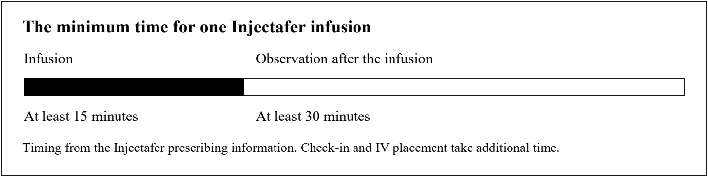

---
# Sources (not rendered):
# Injectafer infusion at least 15 minutes; monitor at least 30 minutes and until clinically stable; 750 mg x2 at least 7 days apart for >=50 kg; single-dose 15 mg/kg up to 1,000 mg for adults; patient-information allergy symptoms -> https://dailymed.nlm.nih.gov/dailymed/fda/fdaDrugXsl.cfm?setid=517b4a19-45b3-4286-9f6a-ced4e10447de
# IV iron when oral iron not tolerated, ferritin does not improve, or absorption unlikely; IV iron for IBD with active inflammation -> https://gastro.org/clinical-guidance/management-of-iron-deficiency-anemia/
# Hemoglobin and iron-deficiency anemia basics -> https://www.nhlbi.nih.gov/health/anemia/iron-deficiency-anemia
title: 'When an Iron Pill Falls Short'
author: Anay Gupta
category: public health
date: 2026-11-24T00:00:00.000Z
layout: layouts/post.njk
tags:
  - health
  - medicine
  - anemia
  - patient care
excerpt: >-
  An IV can get iron past the gut. The half hour after the drip stops is part
  of what that choice involves.
image: /assets/images/2026/when-an-iron-pill-falls-short.jpg
image_credit: 'Adrian Wressell, Heart of England NHS FT / Wellcome Collection (CC BY 4.0), cropped and converted to black and white'
---

The instructions for one form of IV iron give the infusion at least 15 minutes. Then they call for at least 30 more minutes of observation. By then the medicine has gone in, but the patient is still in the chair. If a ride is waiting outside, the second number matters more than the first.

Anyone coming in for a first iron infusion has two separate questions. Why did the clinician choose an IV when iron comes in a pill? And what has to happen before the patient can leave? One answer starts in the gut. The other is in the fine print of the drug label.

## What the pill has to do

Iron helps the body make hemoglobin, the protein red blood cells use to carry oxygen. When someone has [iron-deficiency anemia](https://www.nhlbi.nih.gov/health/anemia/iron-deficiency-anemia), the body needs more iron to make enough healthy red blood cells. An iron pill is a common starting point. To do its job, the iron has to be absorbed through the digestive tract.

That can be the part that goes wrong. A digestive condition such as inflammatory bowel disease can interfere with absorption. Some people have side effects that make the pills hard to take. Others finish a trial of pills and still have low iron stores, which clinicians can assess with a blood test called ferritin. The [American Gastroenterological Association](https://gastro.org/clinical-guidance/management-of-iron-deficiency-anemia/) lists these as reasons to use IV iron. Giving iron through a vein bypasses the absorption step.

## Why the chair stays occupied

The label is for ferric carboxymaltose, sold as Injectafer. When it's given as an infusion, the [label](https://dailymed.nlm.nih.gov/dailymed/fda/fdaDrugXsl.cfm?setid=517b4a19-45b3-4286-9f6a-ced4e10447de) calls for at least 15 minutes of administration and at least 30 minutes of observation afterward, with the patient clinically stable before monitoring ends. Staff are watching for a potentially serious allergic reaction. The patient information lists symptoms such as trouble breathing, swelling and lightheadedness that patients should report right away.

Those two intervals alone add up to at least 45 minutes from the start of the drip. That's before check-in or getting the IV placed. The timing belongs to one drug and one way of administering it. A clinic can use that number to explain the observation period and give a separate estimate for how long the whole visit will take.

## One visit or two

There's a second scheduling question. For iron-deficiency anemia, the Injectafer label describes a two-dose course for patients who weigh at least 50 kilograms, with doses at least a week apart. It also gives a single-dose option for adults in that weight group. The choice affects how often a patient has to make the trip, so the number of visits belongs in the appointment instructions alongside the length of each one.

Replacing iron also leaves a question for after the visit. Why was it low in the first place? An infusion can deliver the iron the body needs. It can't explain whether the shortage came from blood loss, an absorption problem or something else. That answer may take more follow-up, even after the infusion appointments are over.

A patient arranging a ride needs to know when they can expect to leave and whether they'll have to come back next week. Telling them both, and explaining why staff keep watching after the bag is empty, makes the visit easier to plan and the waiting easier to understand.

## Sources

- [NIH National Heart, Lung, and Blood Institute guide to iron-deficiency anemia](https://www.nhlbi.nih.gov/health/anemia/iron-deficiency-anemia)
- [American Gastroenterological Association guidance on iron deficiency anemia](https://gastro.org/clinical-guidance/management-of-iron-deficiency-anemia/)
- [DailyMed prescribing and patient information for Injectafer](https://dailymed.nlm.nih.gov/dailymed/fda/fdaDrugXsl.cfm?setid=517b4a19-45b3-4286-9f6a-ced4e10447de)
- Photo: [Wellcome Collection](https://wellcomecollection.org/works/eph4rfqw), [CC BY 4.0](https://creativecommons.org/licenses/by/4.0/)
